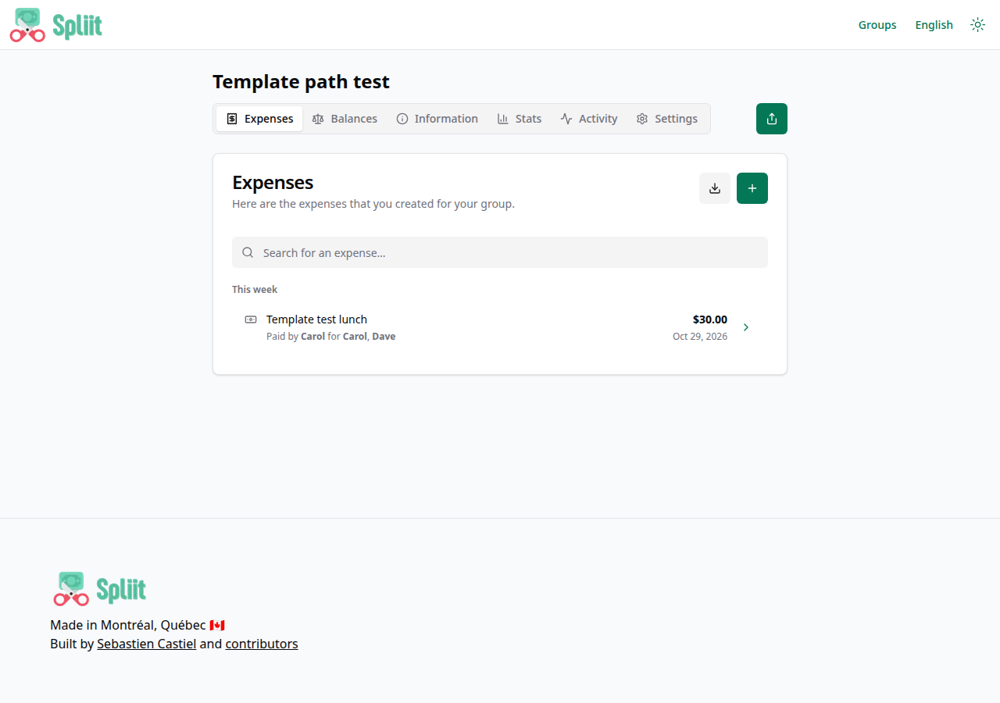

# Spliit

Spliit is a free, open-source alternative to Splitwise: share expenses
with friends and family, track who paid what, and settle up with minimal
friction. No accounts, no sign-up, no email verification — create a
group, add expenses, and share the link.

## Deploy and Host

Deploy it on Railway in one click: two services (the Spliit app plus a
PostgreSQL companion), one volume for the database, and a zero-field
deploy form. Everything is auto-wired: the database password is
generated, the app finds the database over Railway's private network,
and the public URL is set automatically. The moment the deploy turns
green, open the public URL, create a group, add an expense, and the
balance view proves the whole cycle before you share a link with
anyone real.

## Why Deploy

- **No accounts to manage.** Groups are shared by link, so there is no
  registration wall, no password to forget, and no email round-trip
  before the first expense exists.
- **Your money math, your server.** Groups, expenses, and balances live
  in your own PostgreSQL database — not on a third-party ledger.
- **Built for the group chat.** One link per group, per-person balances,
  multi-currency support, and a clean mobile-friendly UI for splitting
  rent, trips, dinners, and shared subscriptions.
- **Light and always on.** A single Next.js service plus Postgres — no
  workers to feed, no queue to drain, no S3 required for the core flow.

## Common Use Cases

- Splitting rent, utilities, and groceries with roommates.
- Tracking shared costs on a group trip, then settling up at the end.
- Dividing dinners, gifts, and subscriptions among friends and family.
- A household ledger where everyone can see who owes whom at a glance.

## Configuration

Every variable the deployment consumes. The one-click deploy form is
zero-field: the two wired variables below are filled automatically,
and the optional upstream features stay off unless you set them after
deploying.

| Variable | Default | What it does |
|---|---|---|
| `SPLIIT_DB_HOST` | `${{postgres.RAILWAY_PRIVATE_DOMAIN}}` | Postgres host over the private network (auto-wired). |
| `SPLIIT_DB_PASSWORD` | `${{postgres.POSTGRES_PASSWORD}}` | Postgres password (auto-wired from the companion). |
| `BASE_URL` | _(derived at boot)_ | Public URL of this deployment, used for metadata links. The entrypoint derives it from `RAILWAY_PUBLIC_DOMAIN` — it is not a deploy-form field, because a variable value of `https://${{RAILWAY_PUBLIC_DOMAIN}}` resolved to a bare `https://` in testing and crashed page renders. |
| `DEFAULT_CURRENCY_CODE` | `USD` | Currency pre-selected on the new-group form (e.g. `EUR`, `CAD`). |
| `ENABLE_GROUP_DELETION` | `false` | Allow deleting groups (needs a scheduled call to `/api/cron/purge-deleted-groups` with `CRON_SECRET`). |
| `CRON_SECRET` | _(unset)_ | Secret protecting the group-purge cron endpoint. |
| `ENABLE_EXPENSE_DOCUMENTS` | `false` | Attach images/files to expenses (requires the `S3_UPLOAD_*` variables). |
| `S3_UPLOAD_KEY` / `S3_UPLOAD_SECRET` / `S3_UPLOAD_BUCKET` / `S3_UPLOAD_REGION` / `S3_UPLOAD_ENDPOINT` | _(unset)_ | S3-compatible storage for expense documents (`S3_UPLOAD_ENDPOINT` only for non-AWS providers). |
| `ENABLE_RECEIPT_EXTRACT` | `false` | Create expenses by scanning receipts (requires expense documents + `OPENAI_API_KEY`). |
| `ENABLE_CATEGORY_EXTRACT` | `false` | Auto-suggest an expense category from its title (requires `OPENAI_API_KEY`). |
| `OPENAI_API_KEY` / `OPENAI_BASE_URL` / `OPENAI_MODEL_RECEIPT_EXTRACT` / `OPENAI_MODEL_CATEGORY_EXTRACT` | _(unset)_ / OpenAI default / `gpt-5-nano` / `gpt-5-nano` | OpenAI-compatible provider for receipt and category features. |
| `ANALYTICS_PROVIDER` | _(unset)_ | Analytics provider(s), comma-separated: `console`, `plausible`, `umami`. Disabled unless set. |
| `PLAUSIBLE_DOMAIN` / `UMAMI_WEBSITE_ID` | _(unset)_ | Site identifiers for the matching analytics provider. |
| `POSTGRES_PASSWORD` (postgres service) | `${{secret(32)}}` | Auto-generated database password. |
| `POSTGRES_USER` / `POSTGRES_DB` (baked) | `spliit` / `spliit` | Database user and name, baked into the companion image. |

## Practical detail

- Runtime: Next.js standalone server + PostgreSQL 16.
- Port: the app listens on Railway's injected `PORT` (3000 fallback) on
  `0.0.0.0`; the healthcheck is `GET /api/health/readiness`.
- Persistence: Postgres data lives on a Railway volume at
  `/var/lib/postgresql/data` (database files in the `pgdata` subdir).
  The app service itself is stateless — expense documents are off by
  default, and enabling them requires S3, so no app volume is needed.
- First boot runs `prisma migrate deploy`, which creates the schema
  idempotently and doubles as the database readiness gate.
- Upstream: [spliit-app/spliit](https://github.com/spliit-app/spliit)
  1.30.0, MIT licensed, pinned by digest in the wrapper Dockerfile.

### Deployment Dependencies

- Railway Hobby plan or higher (two always-on services).
- Memory at rest: roughly 300–500 MB for the app service and ~150 MB
  for Postgres; comfortably inside a single-service limit.
- One persistent volume (Postgres data). No GPU, no Docker socket, no
  special kernel features.
